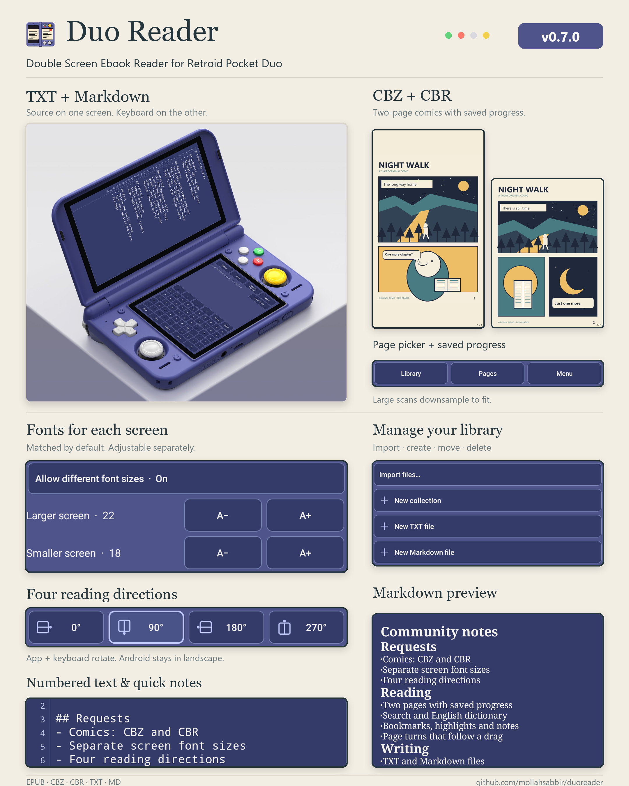

# Duo Reader

An offline EPUB/comic reader and TXT/Markdown editor for Retroid Pocket Duo.
Uses both displays through standard Android APIs, with no launcher dependency.



[Download APK](https://github.com/mollahsabbir/duoreader/releases/latest) ·
[Changelog](CHANGELOG.md) · [Original reading poster](docs/poster.png)

## Features

**Reading**

- EPUB 2/3: two consecutive pages, with per-book progress and resume after restarts.
- CBZ/CBR: two-page comic spreads, natural filename order, page picker, covers,
  saved progress and downsampling for large scans.
- EPUB fonts, text size, line spacing, margins, left/justified/right alignment,
  brightness and light/warm/night page colors.
- Physical font-size matching across displays by default; optional independent
  sizes for the larger and smaller screens.
- Synchronized EPUB page curls with corner lift, tilt, correct reflected text,
  finger tracking and speed-sensitive release.
- Contents, full-text search with highlighted matches, bookmarks, colored
  highlights and an offline English dictionary.
- Notes with visible passage badges, multiline editing, line numbers, soft wrap
  and vertical scrolling. Tap a note badge to read or edit it.

**Writing**

- Create and edit `.txt`, `.md` and `.markdown` files; preview Markdown offline.
- Source/preview on the larger screen; a compact, themed keyboard and controls
  on the smaller screen. D-pad cursor movement follows wrapped lines.
- Larger-screen touch selection with Copy/Paste/Select all; plain-text paste,
  Unicode and normalized line endings.
- Undo/redo, explicit Save, recovered unsaved drafts and cursor restoration.
  Saves preserve text encoding/line endings and protect externally changed files.

**Library and controls**

- A chosen Android folder and its collections, book covers, excerpts and themed
  collection icons.
- Create collections/documents; move files or collections, including back to
  the root. Moves retain reading data; deletion asks for confirmation.
- Import supported files from other locations into the current collection.
  Originals remain intact; duplicate filenames receive a number.
- Four persistent app orientations, with the D-pad at the bottom by default.
  Content and keyboard rotate internally while Android stays in landscape.
- Optional matching page areas, with borders on one pair of sides; transparent,
  auto-hiding reading controls that overlay the page without resizing it.
- Five library themes: GC, Ice Blue, Clear Purple, 16Bit and Black.
- Button navigation, configurable EPUB keybindings and smaller-screen touch
  controls. Both displays open, minimize and close together.
- Local reading positions and annotations; no account, sync, network permission
  or bundled books.

## Use

1. Download **Duo-Reader.apk** from [Releases](https://github.com/mollahsabbir/duoreader/releases/latest)
   under **Assets**. Install over the previous version to retain app data.
2. Open **Preferences → Choose Android folder** and select your document folder.
   Subfolders become collections. Existing users may need to select the folder
   again to grant write access for editing and library management.
3. Open a document. In an EPUB, tap the smaller page for controls; long-press
   text to highlight, copy, annotate or define it. Tap its upper-right corner
   to bookmark. **Library** in the top quick menu returns to browsing.

Choose rotation and matched page areas in **Menu/Preferences**. Separate EPUB
font sizes require **Advanced display settings → Allow different font sizes**.

Use **+** to create collections/TXT/Markdown files or **Import files** to copy up
to 64 supported files from Android's picker. **Manage** moves or deletes the
selected item. Some providers support moving individual files but not whole folders.

In the editor, **Save** writes the original; unsaved edits remain local drafts.
**Source / Preview** switches Markdown views. Long-press source text on the larger
screen for selection and clipboard actions. **Select** or **D-pad: Cursor/Keys**
switches between cursor movement and keyboard navigation; **A** selects a key.
**Y** inserts a space, **L1** deletes and **R1** inserts a newline.

| EPUB control | Default action |
| --- | --- |
| D-pad up / down | Font size up / down |
| D-pad left / right; L1 / R1 | Previous / next spread |
| A / B | Show controls or confirm / back |
| X / Start | Menu |
| Y | Bookmark the smaller page |
| Select | Library |

In the library, up/down selects; right/A opens; left/B goes to the parent.
Change EPUB shortcuts in **Menu → Keybindings**. Comics use left/right or
L1/R1 to turn spreads; tap the smaller screen for page controls.

## Compatibility and limits

Tested by the maintainer on Retroid Pocket Duo. A user reported the earlier EPUB
release working on AYN Thor; the maintainer has not tested that device. This is a pre-1.0
app; the next focus is polish, broader testing and bug fixes.

- EPUB: unencrypted, reflowable EPUB 2/3. No PDF, DRM, fixed layouts, full publisher
  CSS, embedded fonts or scripting. Font controls apply to EPUB, not image scans.
- Text: UTF-8 or BOM-marked UTF-16; up to 2 MB / 524,288 characters / 20,000 lines.
  Markdown preview is limited to 262,144 characters. Drafts save after a short pause.
- Comics: ZIP/RAR 4/5; PNG, JPEG, WebP, GIF and BMP images. Limits: 2 GB archive,
  10,000 entries, 64 MB per extracted image and 32 MB RAR dictionary. No encrypted
  or multipart archives. Damaged/unsupported scans show an error; GIFs are static.
- Reading data and drafts stay in app storage. Clearing app data or uninstalling
  removes them; there is no backup/export or cloud sync.

## Build

Windows, PowerShell 7, JDK 17, Android SDK platform **35** and build-tools
**35.0.0**. Set `JAVA_HOME` and `ANDROID_SDK_ROOT`; no Gradle is required.
The build downloads checksum-pinned parser dependencies into `.local/dependencies`.

```powershell
.\build.ps1                 # Signed APK in dist/
.\tools\verify.ps1          # Compile app + instrumentation; no device access
```

`-Debug` builds a debuggable APK in `build/`. Device tests require an explicit
`-Run -Serial SERIAL`; use a test profile because they exercise saved settings.
Tests generate their own EPUB/text/comic fixtures. For force-stop recovery checks
after installing debug/test APKs, run `python tools/test-documents.py --serial SERIAL --adb PATH`.

Keep `.local/duoreader-debug.keystore` private and backed up. A different signing
key cannot update an existing installation. Outputs, local tools, keys and test
results are excluded from Git.

Source: `app/` · device tests: `tests/` · build/dictionary tools: `tools/`.

## LLM Usage Statement

OpenAI Codex was used extensively for code, UI design, refactoring, tests and
documentation, guided by the maintainer's requirements and feedback. AI image
tools were used for the app icon. Posters use actual screenshots composed
programmatically. The app has no LLM integration or AI service calls and runs offline.

## Licensing

Original code: [MIT](LICENSE). The dictionary, dependencies and third-party
poster imagery retain their own terms; see [notices](THIRD-PARTY-NOTICES.md).
No book files or embedded book fonts are distributed in the repository or APK.
