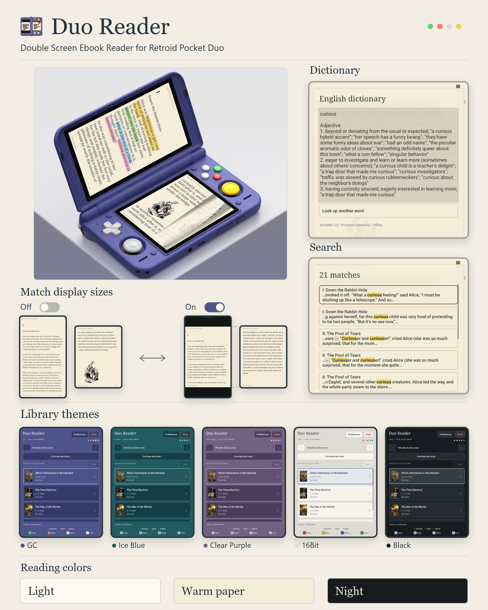

# Duo Reader

An offline reader and text editor for Retroid Pocket Duo. Read two consecutive
EPUB pages while Android stays in landscape. Uses standard Android display APIs;
no launcher dependency.



## Features

- Local folders and collections, covers, previews, and per-book reading progress.
- Create collections/TXT/Markdown files; move or delete library items. Moves keep
  saved reading data; deletion asks for confirmation.
- Button-only or smaller-screen touch control; the larger screen ignores touch.
- Adjustable fonts, size, spacing, margins and brightness; three page colors.
- Left/justified/right text, density-matched font sizes, and four internal rotations.
- TXT/Markdown editing with line numbers, soft wrap, shared keyboard, undo/redo,
  recoverable drafts, and offline Markdown preview on the larger display.
- CBZ/CBR comics with naturally ordered pages, covers, and bounded scan decoding.
- Five library themes and customizable collection icons.
- Synchronized page curls that follow a drag and respond to release speed.
- Optional matching page sizes, with borders on one pair of sides.
- Contents, full-text search, bookmarks, colored highlights and notes.
- Integrated offline English dictionary and configurable reading shortcuts.
- Saved positions and annotations persist across app/process restarts; both
  displays open, minimize and close together.

## Use

1. Download **Duo-Reader.apk** from [Releases](https://github.com/mollahsabbir/duoreader/releases)
   under **Assets** and install it, or build it below.
2. Open **Preferences → Choose Android folder** and select a folder containing
   your documents. Subfolders become collections. No books are bundled.
3. Hold the Duo like a book, D-pad at the bottom. Tap the smaller page to show
   controls; long-press text to highlight, copy, annotate or define it. Tap its
   upper-right corner to bookmark. **Library** in the top quick menu returns to browsing.

Rotation and matching page sizes are in Preferences. Separate font sizes require
**Menu → Advanced display settings → Allow different font sizes**.
In the editor, **Save** writes the original file; unsaved edits are kept as local drafts.
Use **+** to create items and **Manage** for the selected item. Existing folders
may need to be chosen again to grant write access. Providers that cannot move
whole collections can still move individual files.

| Reading control | Default action |
| --- | --- |
| D-pad up / down | Font size up / down |
| D-pad left / right; L1 / R1 | Previous / next spread |
| A / B | Show controls or confirm / back |
| X / Start | Menu |
| Y | Bookmark the smaller page |
| Select | Library |

In the library, up/down selects; right/A opens; left/B goes to the parent.
Change reading shortcuts in **Menu → Keybindings**.

## Build

Windows, PowerShell 7, JDK 17, Android SDK platform **35** and build-tools
**35.0.0**. Set `JAVA_HOME` and `ANDROID_SDK_ROOT`; no Gradle is required.
The build fetches checksum-pinned parser dependencies into `.local/dependencies`.

```powershell
.\build.ps1                 # Signed APK in dist/
.\tools\verify.ps1          # Compile app + instrumentation; no device access
```

`-Debug` builds a debuggable APK in `build/`. Device tests require an explicit
`-Run -Serial SERIAL`; use a test profile because they exercise saved settings.
Tests generate their own EPUB fixtures.

Keep `.local/duoreader-debug.keystore` private and backed up. A different signing
key cannot update an existing installation. Build outputs, local tools, keys
and test results are excluded from Git.

Source: `app/` · instrumentation: `tests/` · build/dictionary tools: `tools/`.

## LLM Usage Statement

OpenAI Codex was used extensively for code, UI design, refactoring, tests, and
documentation, guided by the maintainer's requirements and feedback. AI image
tools were used for the app icon. The app itself has no LLM integration or AI
service calls and runs offline.

## Limits and licensing

Supports unencrypted, reflowable EPUB 2/3 and UTF-8/BOM-marked UTF-16 text.
Text editing is limited to 2 MB / 524,288 characters; Markdown preview to 262,144
characters. Drafts autosave after a short typing pause. No PDF, DRM, full publisher CSS,
embedded fonts, scripting, or fixed-layout support. Tested on Retroid Pocket
Duo; other dual-display devices may differ. Reading data stays local and is
removed by clearing app data or uninstalling; no sync or export is provided.

Comics: ZIP/RAR 4/5, up to 2 GB, 10,000 entries, 64 MB per extracted image,
and a 32 MB RAR dictionary. Large scans downsample to screen size. Password-protected
and multipart archives are unsupported; unusually large dictionaries or damaged scans
show an error. The app never extracts a whole comic at once.

Original code: [MIT](LICENSE). The dictionary and third-party imagery in the
poster retain their own terms; see [notices](THIRD-PARTY-NOTICES.md).
